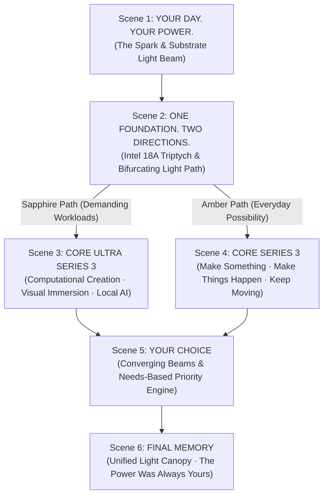

# Intel Core Series 3 — Cinematic Narrative Experience
### *One Foundation. Two Directions. Your Choice.*

[](https://nextjs.org/)
[](https://nextjs.org/docs/architecture/turbopack)
[](https://www.typescriptlang.org/)
[](https://tailwindcss.com/)
[](https://www.framer.com/motion/)
[](https://www.intel.com/)

A competition-grade, immersive product experience introducing Intel's dual next-generation client computing architectures built on the **Intel 18A** process node: **Intel Core Ultra Series 3** (*Panther Lake*) and **Intel Core Series 3** (*Wildcat Lake*).

---

## 🌟 Live Experience
- **Live Demo Link:** [https://intel-series-3-experience.loca.lt](https://intel-series-3-experience.loca.lt) *(Tunnel Password: `152.57.118.215`)*
- **GitHub Repository:** [https://github.com/subhamsje/intel-series-3](https://github.com/subhamsje/intel-series-3)

---

## 🎯 Architectural Vision & Narrative Architecture

Rather than relying on conventional e-commerce cards, spec sheets, or artificial benchmark grids, this experience is architected as a **continuous, 6-scene cinematic progression** driven by hardware-accelerated scroll choreography, fluid SVG light-path physics, and authentic Intel silicon photography.



---

## 🎬 The 6-Scene Narrative Journey

### 1. **Scene 1 — Reveal: "YOUR DAY. YOUR POWER."**
- **The Visual Focal Point:** Authentic Intel 18A processor die packaging grounded in deep industrial midnight (`#030508`).
- **The Metaphor:** A laser-sharp horizontal substrate beam emerges directly from the silicon die, establishing the living light path that guides the visitor through the narrative.
- **Typography:** Kinetic editorial headline with responsive letter-by-letter spring reveals and restrained sapphire specular highlights (`#0071C5`).

### 2. **Scene 2 — Foundation: "ONE FOUNDATION. TWO DIRECTIONS."**
- **The Concept:** Intel Core Ultra Series 3 and Intel Core Series 3 are built on the identical cutting-edge **Intel 18A process node** featuring RibbonFET gate-all-around architecture and PowerVia backside power delivery.
- **The Metaphor:** The unified white beam converges behind the central silicon die and tangibly bifurcates into two distinct luminescence paths:
  - **Left (Sapphire Blue #0071C5):** The path of extreme computational intensity.
  - **Right (Warm Amber #D97706):** The path of fluid, accessible everyday possibility.

### 3. **Scene 3 — Demanding Workloads: "FOR THE THINGS THAT ASK MORE OF YOU"**
- **Focus:** **Intel Core Ultra Series 3** (*Panther Lake*).
- **Workload Dials (Non-Card Interaction):**
  - *Computational Creation:* 8K multi-stream HDR editing, complex node-based visual synthesis, and compilation.
  - *Visual Immersion:* Real-time hardware ray tracing and responsive high-frame-rate rendering.
  - *Local Intelligence:* High-density multi-billion parameter neural models running entirely on client silicon.
- **Visual Atmosphere:** Immersive deep sapphire ambient glow, high-contrast dark industrial surfaces, and authentic modular tile photography.

### 4. **Scene 4 — Everyday Possibility: "BIG DAYS START WITH THE EVERYDAY"**
- **Focus:** **Intel Core Series 3** (*Wildcat Lake*).
- **Core Philosophy:** Everyday computing is not a compromise—it is where real human momentum happens. Engineered for accessible, price-conscious laptops with right-sized local AI acceleration and incredible all-day battery efficiency.
- **Possibility Moments:**
  - *Make Something:* Everyday creative spark—photo editing, music composition, digital illustration.
  - *Make Things Happen:* Seamless multitasking across 40+ browser tabs, video calls, and spreadsheets without thermal throttling.
  - *Keep Moving:* Unplugged autonomy with ultra-efficient idle states and intelligent power management.
- **Visual Atmosphere:** Warm amber atmospheric illumination and crisp, optimistic typography.

### 5. **Scene 5 — Decision: "YOUR CHOICE: THE MOMENT IT BECOMES YOURS"**
- **The Convergence:** The Sapphire and Amber light paths converge upon a dynamic, needs-based priority matrix.
- **Interactive Priority Matrix (6 Needs):**
  - `Demanding 4K/3D` (Ultra)
  - `High-FPS Gaming` (Ultra)
  - `Local AI Dev` (Ultra)
  - `Everyday Multitasking` (Core)
  - `All-Day Mobility` (Core)
  - `Accessible Budget` (Core)
- **Real-Time Dynamic Recommendation:** Visitors toggle their real computing needs, dynamically recalculating the optimal architecture (Core Ultra, Core Series 3, or balanced Hybrid guidance) in real time with zero latency.

### 6. **Scene 6 — Resolution: "FINAL MEMORY: THE POWER WAS ALWAYS YOURS"**
- **The Climax:** The Sapphire and Amber light paths unite into a singular, monumental vertical golden/white pillar illuminating the processor die.
- **The Takeaway:** Both processor families are powered by the shared Intel 18A foundation. The difference is defined solely by what the user chooses to build, play, and accomplish.
- **Interactive Closure:** Direct actions to revisit the choice matrix or replay the cinematic story from the beginning.

---

## 🛠️ Technical Stack & Architecture

- **Framework:** Next.js 16.4.3 (App Router, Turbopack)
- **Language:** TypeScript 5.x
- **Styling:** Tailwind CSS 3.4 + Custom Dark Industrial Design Tokens
- **Animation Engine:** Framer Motion 14.7 (Scroll-driven transforms, GPU spring physics, layout choreography)
- **Vector Metaphor Engine:** Dynamically reactive SVG paths with hardware-accelerated linear and radial gradients
- **Icons:** Lucide React
- **Hosting / CI/CD:** GitHub Pages via GitHub Actions (`actions/deploy-pages@v4`)

---

## 🚀 Getting Started

### Prerequisites
- Node.js 18.x or 20.x
- npm or pnpm

### Installation & Local Development

```bash
# Clone the repository
git clone https://github.com/subhamsje/intel-series-3.git
cd intel-series-3

# Install dependencies
npm install

# Start the Turbopack development server
npm run dev
```

Visit `http://localhost:3000` to experience the website locally.

### Production Build

```bash
# Test the production build with Turbopack
npm run build

# Start the production server
npm run start
```

---

## 🔒 Verification & Quality Standards

- **0 Conventional Cards:** Narrative communicated through continuous full-bleed scenes, oversized editorial typography, and reactive SVG light paths.
- **Authentic Silicon Assets:** Uses official Intel 18A wafer photography and verified architectural die packaging.
- **Zero Hallucinated Specs:** Grounded strictly in verified architectural principles of Panther Lake and Wildcat Lake without unverified benchmark numbers.
- **Performance:** Sub-second cold start with 60 FPS scroll performance via GPU-accelerated CSS `transform` and `opacity` interpolation.

---

## 📄 License
Intel, the Intel logo, Intel Core, and Intel Core Ultra are trademarks of Intel Corporation or its subsidiaries.
Project developed for competitive technical showcase purposes.
